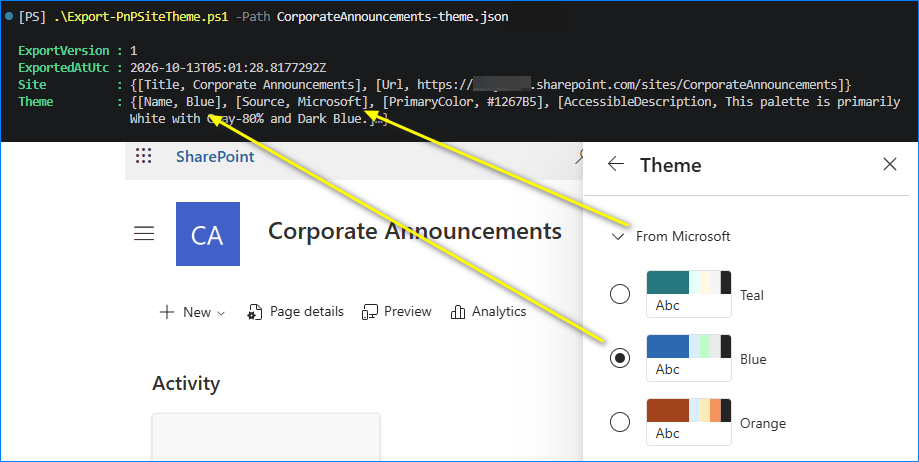
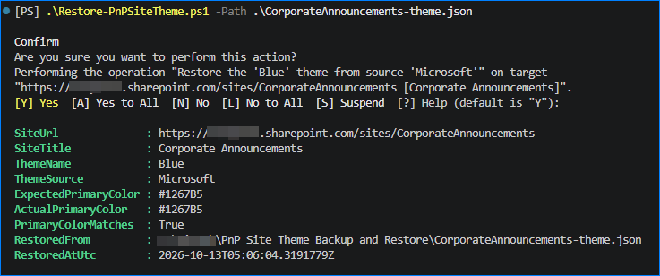

# PnP Site Theme Backup and Restore

A small PowerShell utility for backing up the current modern theme configuration of a SharePoint Online site and restoring it later.

It supports custom tenant themes and built-in (Microsoft) themes.

The export records the detected theme name and source, site details, primary color, theme metadata, and available palette values in JSON. The restore script applies the exported theme by name and validates the resulting primary color.

## Requirements

- PowerShell 7
- [PnP PowerShell](https://pnp.github.io/powershell/)
- Access to the target SharePoint Online site
- Appropriate SharePoint administrator permissions to manage and apply tenant themes

## Scripts

- `Export-PnPSiteTheme.ps1` exports the current site theme to JSON.
- `Restore-PnPSiteTheme.ps1` restores a previously exported theme.

## Usage

### 1. Connect to the site

```powershell
Connect-PnPOnline `
    -Url 'https://contoso.sharepoint.com/sites/TestSite' `
    -Interactive `
    -ClientId '<App-Client-ID>'
```

### 2. Export the current theme

```powershell
.\Export-PnPSiteTheme.ps1 `
    -Path '.\TestSite-Theme.json'
```



Keep the generated JSON file with the change record or deployment artifacts so it is available if rollback is required.

### 3. Preview a restore

```powershell
.\Restore-PnPSiteTheme.ps1 `
    -Path '.\TestSite-Theme.json' `
    -WhatIf
```

### 4. Restore the exported theme

```powershell
.\Restore-PnPSiteTheme.ps1 `
    -Path '.\TestSite-Theme.json'
```



To suppress the confirmation prompt:

```powershell
.\Restore-PnPSiteTheme.ps1 `
    -Path '.\TestSite-Theme.json' `
    -Confirm:$false
```

## Cross-site restore

The restore script normally verifies that the connected site matches the URL stored in the backup. To intentionally apply the exported theme to another site:

```powershell
.\Restore-PnPSiteTheme.ps1 `
    -Path '.\TestSite-Theme.json' `
    -IgnoreSiteUrlMismatch `
    -Confirm
```

## Caveats

- Microsoft built-in theme names are inferred from their documented primary colors because SharePoint does not expose their friendly names through the site theme information returned by PnP.
- Tenant themes are matched by their stored theme name and primary color.
- A custom tenant theme must still exist in the tenant when it is restored. The restore script does not recreate a deleted tenant theme from the exported palette.
- If more than one theme uses the same primary color, theme detection may be ambiguous.
- Themes with an unknown source or without a detected name are exported for reference but are not automatically restored.
- The Microsoft 365 suite bar at the top of SharePoint is controlled by organizational branding and is outside the scope of these scripts.
- Always run the restore with `-WhatIf` first and test in a non-production site before wider use.

## Notes

Adding or updating a tenant theme and applying a theme to a site are separate operations. These scripts back up and restore the theme selected for a site; they are not a full tenant-theme lifecycle management solution.

## References

- [Built-in Microsoft Themes Schema and Primary Colors](https://learn.microsoft.com/en-us/sharepoint/dev/declarative-customization/site-theming/sharepoint-site-theming-json-schema)

## License

Use and modify this project according to the license included in the repository.
